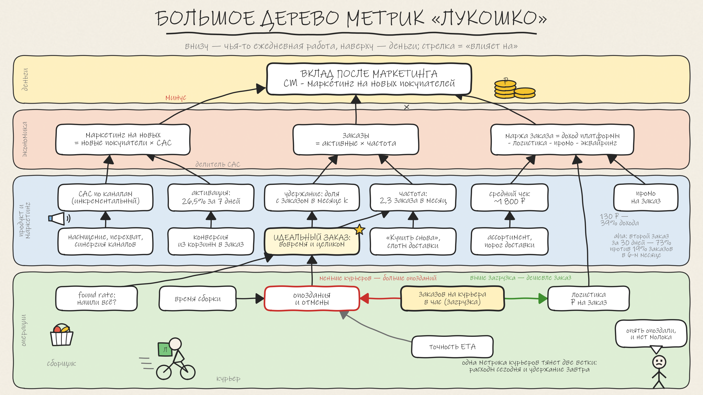

# Лекция 4. От пользователя до P&L

📺 [Запись лекции — плейлист курса на YouTube](https://www.youtube.com/playlist?list=PLPlYipDKg8po) ·
📄 [Слайды (PDF)](../pdf/lecture-04-user-to-pnl.pdf) · ⬅️ [Все лекции](../README.md)

Путь одного покупателя «Лукошка» от рекламы до P&L. Сколько стоит его привлечь, сколько он принесёт и когда вернёт деньги,
почему каналы нельзя просто сложить, как продукт удешевляет маркетинг и почему в операционном бизнесе сборщик и курьер
двигают удержание и прибыль. Лекция связывает лекции 2 (маркетинг) и 3 (продукт) в одну цепочку денег.

Первые семь слайдов — окончание [лекции 3](../лекция-03-цели-и-метрики-продукта/README.md): спиральная динамика работы
с данными, девять ступеней зрелости, жанры задач аналитика и ML-инженера, «эстафета со сломанным переводом» и четыре уровня
метрики. Сама лекция 4 начинается со слайда 8.

**Вопрос лекции.** «Мы заплатили около 1 050 ₽ за нового покупателя. Когда эти деньги вернутся — и кто, кроме маркетинга,
на это влияет?»

## Главные тезисы

**1. CAC рождается в воронке, а не в рекламном кабинете.**
CAC = расход на привлечение / новые покупатели = цена регистрации / активация. Кабинет видит клик, бизнес платит за покупателя.

**2. Честный CAC включает промокод новичку и реферальные бонусы.**
Blended CAC «Лукошка» — 640 ₽, paid CAC — 1 050 ₽: 39% новых покупателей приходят сами. Решения о бюджете принимают
по paid CAC, а лучше — по инкрементальному.

**3. Дешёвый клик ≠ дешёвый покупатель.**
Первый заказ за 7 дней после регистрации делают 17–18% пришедших из CPA-сетей и соцсетей и 30–34% — из бренда и органики.
При одинаковой цене регистрации покупатель из CPA-сети обходится вдвое дороже.

**4. LTV считаем по марже и смотрим как кривую.**
За год покупатель «Лукошка» делает 11,2 заказа: оборот 19 967 ₽, маржа 1 783 ₽. По обороту CAC «окупается» на первом заказе.
По марже paid CAC окупается на 7-й месяц, а покупатель из CPA-сетей — на 10-й.

**5. Payback важнее LTV/CAC.**
Payback — срок, на который компания кредитует покупателя. CAC +20% сдвигает payback с 7 на 8 месяцев.

**6. LTV раскладывается на продуктовые метрики.**
LTV = Σ по месяцам: удержание × частота × чек × маржинальность (доля маржи в чеке). У каждого множителя свой владелец: продукт, CRM, категории, логистика.

**7. P&L месяца = маржа всех когорт − маркетинг на новых.**
Старые когорты кормят новые. Месяц с большим привлечением (например, распродажа) уходит в минус, хотя «бизнес вырос».
Так DoorDash объяснял свой P&L инвесторам перед IPO.

**8. Каналы нелинейны.**
Насыщение, перехват, синергия, инерция, аукцион — поэтому сумма отчётов каналов больше реальных заказов.
Удвоили бюджет канала — заказов +38% (учебная кривая насыщения). Удвоили ретаргет — по last click новых покупателей +20%,
а регистраций +2% к тренду.

**9. Атрибуция — договорённость, инкремент — эксперимент.**
Ретаргету достаётся от 15% до 74% заслуги за новых покупателей — в зависимости от модели атрибуции. Инкремент меряют холдаутом,
выключением канала, гео-тестом и MMM, откалиброванной экспериментами. Uber отключил две трети рекламного бюджета — установки не упали.

**10. Конверсия — делитель CAC.**
+1 п.п. активации (26,5% → 27,5%) удешевляет все платные каналы на 3,6%. Продукт — самый дешёвый маркетинг.

**11. «Лукошко» — операционный бизнес.**
Из чека 1 815 ₽ платформе остаётся 163 ₽ маржи. Логистика — 39% дохода платформы: 494 млн ₽ в месяц, 130 ₽ на заказ.
Скорость доставки обещает реклама, а выполняют обещание сборщик и курьер.

**12. Экономия на курьерах линейна, опоздания — нет.**
В учебной модели очереди −2 курьера в пик дают −8% стоимости доставки и рост опозданий с 4% до 21%.
−10 ₽ логистики на заказ = +112 ₽ к LTV за год, +1 п.п. удержания = +42 ₽. Экономия окупается, только пока удержание
падает меньше чем на 2,7 п.п.

**13. Большое дерево метрик доходит от курьера до P&L.**
Одна метрика — заказов на курьера в час — тянет две ветки: расходы сегодня и удержание завтра.

## Шпаргалка формул

| Что | Как считать |
|---|---|
| CAC | расход на привлечение / новые покупатели = цена регистрации / активация |
| LTV за 12 месяцев | сумма по месяцам: удержание × заказов на активного × чек × маржинальность |
| Payback | первый месяц, когда накопленная маржа когорты на покупателя ≥ CAC |
| P&L месяца | маржа всех когорт в этом месяце − маркетинг на новых покупателей |
| Инкрементальный CAC | расход / покупатели, которых без канала не было бы (по эксперименту) |
| Порог экономии | экономия на заказе окупается, пока потеря LTV из-за удержания меньше прироста LTV от экономии |

## Материалы для самостоятельного изучения

| Материал | Что внутри |
|---|---|
| [Конспект «Маркетинг и инкрементальность»](материалы/конспект-маркетинг-и-инкрементальность.md) · [слайды](../pdf/lukoshko-week-07-marketing-incrementality.pdf) | экономика канала (CAC, ROAS, ДРР, ROMI); атрибуция как договорённость; холдаут, гео-тест, DiD, синтетический контроль, PSM, RDD; MMM и почему её калибруют экспериментами |
| [Конспект «Юнит-экономика, когорты и LTV»](../лекция-02-цели-и-метрики-маркетинга/материалы/конспект.md) · [ноутбук](../лекция-02-цели-и-метрики-маркетинга/материалы/семинар-02.ipynb) | юнит заказа, когорты и удержание, LTV тремя способами, payback; в ноутбуке — LTV/CAC по каналам и стресс-тест CAC +20% |
| [Конспект «Система метрик»](../лекция-03-цели-и-метрики-продукта/материалы/конспект.md) | North Star, дерево метрик до маржи, guardrails |
| [Паспорт «Лукошко»](../сквозной-продукт-лукошко.md) | P&L, юнит заказа, каналы и CAC |
| Кейсы к теме: [неделя 2](../литература/библиотека-кейсов.md#неделя-2), [неделя 7](../литература/библиотека-кейсов.md#неделя-7), [неделя 11](../литература/библиотека-кейсов.md#неделя-11), [неделя 14](../литература/библиотека-кейсов.md#неделя-14) | DoorDash S-1 и когорты (`W02-02`), откат доставки за 15 минут (`W02-06`), Uber и рекламные сети (`W07-03`), Instacart и наличие товаров (`W11-05`), Uber DeepETA (`W11-24`), switchback-тест логистики Delivery Club (`W14-02`) |

## Что почитать

- Fisher, Gallino, Xu — *The Value of Rapid Delivery in Omnichannel Retailing* (Journal of Marketing Research, 2019):
  доставка на один рабочий день быстрее дала +1,45% онлайн-продаж. [Краткий пересказ AMA](https://www.ama.org/research-insights/research-insight-is-faster-delivery-worth-it-for-your-firms-bottom-line/).
- Harter, Stich, Spann — *The Effect of Delivery Time on Repurchase Behavior in Quick Commerce* (Journal of Service Research, 2025):
  опоздание удлиняет паузу до следующего заказа сильнее, чем опережение её сокращает. [Открытая версия](https://epub.ub.uni-muenchen.de/109781/).
- Лекции курса ВШЭ «Маркетинговые каналы» и «Каналы и атрибуция» — [analytics-lectures](https://github.com/gavnukkk97/analytics-lectures):
  карта каналов, примеры рекламы доставки, иерархия доказательств.

Полный список — в [литературе курса](../литература/README.md).
